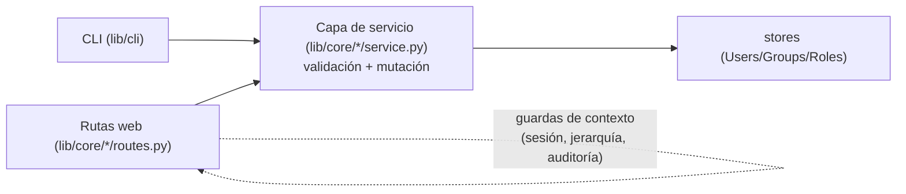

# CLI

`main.py` es a la vez el **lanzador de servicios** (panel web / monitor / syslog / eventos) y una
**herramienta de administración one-shot** (gestión de usuarios y grupos, estado y recarga de
servicios, sede de demostración). Este documento cubre los **subcomandos de gestión**; los *modos de servicio*
(`--web` / `--monitor` / `--syslog` / `--events`) están en
[ref-configuracion.md → Opciones de Línea de Comandos](ref-configuracion.md#opciones-de-línea-de-comandos).

```bash
python3 main.py <opciones-globales> <subcomando> ...
```

Los subcomandos se ejecutan contra un **contexto headless** (solo la BD + los stores que hacen
falta; sin Flask, sin panel web, sin hilos de daemon) y **salen**. Comparten la BD con una
instancia en marcha, así que se pueden lanzar en caliente. Las opciones globales
(`-p/--path`, `-l/--lang`, `--log-level`) van **antes** del subcomando.

> **Nota:** operan directamente sobre los datos como el administrador del sistema — no aplican
> las guardas de contexto del solicitante (no editarte a ti mismo, jerarquía de roles) que sí
> aplican las rutas web; sí aplican las guardas de **datos** (política de contraseña, unicidad,
> "debe quedar al menos un admin activo").

## Como root, con el usuario dedicado

Una instalación de paquete (o `install.sh` nueva) corre los servicios como `servicesentry`, y
`/var/lib/ServiSesentry` es suyo. Un subcomando lanzado **como root** contra esos datos creaba
ficheros de root (el diario de `data.db`, una imagen de la sede de demostración, una base
nueva) que luego los servicios no podían escribir: el panel pasaba a solo-lectura sin nada
que apuntara al CLI.

Ahora, si lo lanza root y el directorio de datos es de otro usuario, el CLI **se convierte en
ese usuario** (grupos, gid y uid) antes de abrir nada. Si no puede, **se niega** con un
mensaje que dice cómo lanzarlo. La forma explícita, que funciona igual en cualquier caso:

```bash
sudo runuser -u servicesentry -- /opt/ServiSesentry/venv/bin/python /opt/ServiSesentry/main.py user mfa-status
```

Una instalación que sigue corriendo como root (anterior al usuario dedicado) no cambia nada:
el directorio es de root y el CLI sigue como root.

---

## Gestión de usuarios (`user`)

| Comando | Descripción |
|---|---|
| `user add <username> [-P PW] [--role R] [--display N] [--email E] [--group G]… [--disabled] [--no-login]` | Crear un usuario. `--password/-P` se pide de forma oculta si se omite. `--role` acepta `admin`/`editor`/`viewer`/`none` o un rol personalizado (por defecto `none`). `--group` es repetible (nombre o uid). `--no-login` crea una **cuenta de servicio**: activa (posee cosas, recibe avisos) pero sin inicio de sesión por ninguna vía — ver [explica-seguridad.md](explica-seguridad.md#cuentas-de-servicio-login_enabled). |
| `user enable <username>` | Activar un usuario |
| `user disable <username>` | Desactivar un usuario (no puede desactivarse el último admin activo) |
| `user passwd <username> [-P PW]` | Cambiar la contraseña (se pide oculta si se omite `-P`) |
| `user role <username> <role>` | Cambiar el rol (no puede quitarse el rol al último admin) |
| `user group-add <username> <group>` | Añadir el usuario a un grupo (por nombre o uid) |
| `user group-del <username> <group>` | Quitar el usuario de un grupo |
| `user unlock <username>` | Levantar el **bloqueo por intentos fallidos**. Aquí además de en el panel porque la cuenta bloqueada puede ser la única que habría podido pulsar el botón |
| `user mfa-reset <username>` | Quitar el **segundo factor** y sus códigos de recuperación. Ver [explica-mfa.md](explica-mfa.md#quitar-el-factor-de-otra-cuenta) |
| `user mfa-status` | Qué cuentas llevan segundo factor, y cuántos códigos de recuperación les quedan |

```bash
python3 main.py user add alice -P 'S3cret!' --role editor --email alice@example.com --group devs
python3 main.py user role alice admin
python3 main.py user disable bob
python3 main.py user passwd bob            # pide la contraseña de forma oculta
python3 main.py user unlock bob            # se equivocó cinco veces
python3 main.py user mfa-reset bob         # perdió el móvil Y los códigos
python3 main.py user mfa-status
```

> **Por qué el reset del MFA está también aquí.** El camino soportado desde la web pide el
> permiso `mfa_reset_others`, que no tiene nadie por defecto; si la única cuenta que lo llevaba
> es justo la que no puede entrar, el panel no ofrece salida. Esto la da desde la máquina, y no
> concede alcance nuevo: quien puede ejecutarlo ya puede leer la base de datos.

## Gestión de grupos (`group`)

| Comando | Descripción |
|---|---|
| `group add <name> [-d DESC] [--role R]…` | Crear un grupo. `--role` (repetible) concede roles al grupo; sus miembros heredan esos permisos. |
| `group del <name>` | Eliminar un grupo (por nombre o uid) y quitarlo de todos los usuarios. Los grupos integrados no se pueden borrar. |

```bash
python3 main.py group add devs -d 'Equipo de desarrollo' --role editor
python3 main.py group del devs
```

## Estado y recarga de servicios

| Comando | Descripción |
|---|---|
| `status` | Muestra el estado de los servicios de fondo (running / stopped / sin instancia), si están habilitados en config y cuántas instancias vivas hay (por latido reciente). |
| `reload` | Encola un comando `reload` para cada servicio-daemon; un proceso en marcha lo drena en su siguiente latido (~10 s), invalida la caché de config y reconcilia (arranca/para según `enabled`). |

```bash
python3 main.py status
python3 main.py reload
```

`reload` no reinicia el proceso: recarga la configuración y deja que cada servicio converja al
estado deseado. Los cambios que sí requieren reinicio del proceso (puerto, proxy_count, BD de
syslog) los indica el panel con su banner de reinicio.

## Sede de demostración (`dcim demo`)

| Comando | Descripción |
|---|---|
| `dcim demo` | Crea la sede **Demo** con todo lo que admite el inventario físico. Se niega si ya existe. |
| `dcim demo --replace` | La borra y la vuelve a crear: así se **actualiza** a la versión de este código. |
| `dcim demo --remove` | La borra con todo lo que cuelga de ella: filas, ficheros de plano y las dos empresas de ejemplo, si nada más las usa. |
| `dcim demo --status` | Dice qué versión de la demo hay instalada (con su fecha), cuál instalaría este código, si hay una más reciente y cuánto tiene de su vigilancia (`monitoring: N devices, M checks`). |
| `dcim demo --quiet` | No escribe cada paso (por defecto, al crearla o borrarla escribe `[n/N] paso` según empieza cada uno: los mismos pasos que el diálogo del panel). |
| `dcim demo --no-images` | La crea sin bajar las fotos del fabricante de los básicos del catálogo que use (por defecto se bajan si hay internet). |

```bash
python3 main.py dcim demo
python3 main.py dcim demo --replace
python3 main.py dcim demo --remove
python3 main.py dcim demo --status
```

La demo tiene **versión** (`DEMO_VERSION` en `lib/core/dcim/demo.py`, que sube con cada cambio de
lo que escribe). Al instalarla se apunta cuál, cuándo y quién (tabla `dc_demo`); al borrarla se
olvida. Si un paso falla, se quita lo que se hubiera creado y se dice en qué paso fue.

Lo mismo se hace desde el panel, en **Configuración › Mantenimiento**: «Instalar Datos de
Demostración» (si ya está, pregunta y la vuelve a crear) y «Borrar Datos de Demostración», con el
permiso `db_maintenance`. Las dos quedan en la auditoría. La tarjeta dice «Datos demo instalados:
versión N (fecha)» —o la versión que se instalaría— y, cuando este código trae una más nueva,
«Hay una versión más reciente (M)» con «Actualizar datos demo», que la borra y la vuelve a crear.
Instalar, actualizar y borrar corren en segundo plano: un diálogo enseña la barra, el paso en
curso con su cuenta, los pasos hechos con su tiempo y, si algo falla, en qué paso (y lo creado se
quita); se puede cerrar y volver a abrir, avisa al terminar, y un segundo clic mientras corre
reabre el diálogo en vez de empezar otro.

La sede tiene:

- **Cinco plantas** (sótano, baja, primera, segunda y tercera), cada una con su plano de fondo en
  SVG, sus muros, puertas hacia el pasillo y ventanas, y una escalera en el mismo punto de todas,
  que en 3D forma un único hueco.
- **Un edificio de verdad**, con 29 salas colocadas:
  - sótano: energía, grupo electrógeno y sala de baterías;
  - baja: comunicaciones de operadores, laboratorio, expediciones, recepción y una sala de
    reuniones grande, y un rack y un cuadro sueltos en la zona general;
  - primera: el CPD principal, el NOC y el almacén técnico;
  - segunda: oficina abierta de 24 puestos, cuatro despachos, dos salas de reuniones, sala de
    formación, office y la sala de comunicaciones de la planta;
  - tercera: sala de servidores refrigerada por splits de pared, sala HPC con pasillo caliente
    confinado y climatizadores en fila, comunicaciones de planta, oficina de 18 puestos, sala de
    reuniones y despacho.
- **Refrigeración de cada tipo**: pasillo frío confinado con CRAC de sala, pasillo caliente con
  climatizadores en fila, splits de pared y sin climatización. Los modelos dicen su flujo de aire
  (servidores de delante a detrás, switches de detrás a delante).
- **Equipos en aviso y en error**: la mayoría de los equipos activos de los CPD y de las salas de
  comunicaciones salen en verde, unos cuantos en aviso y otros en error; el laboratorio queda sin
  vigilar. Las tres sedes pequeñas también tienen estado: casi todo en verde, el cortafuegos
  FW-DR en error (túnel IPsec caído) y el router RTR-PR en aviso (latencia del SD-WAN).
  Cada uno de esos colores lo dan sus comprobaciones, se instale desde el panel o desde la línea
  de órdenes (ver «La vigilancia de la demo», abajo); sin esa parte —quien llame a
  `demo.build` sin panel ni anfitrión— queda el estado de demostración que pinta el inventario
  (`dc_item.demo_state`). Cada equipo lo dice en su descripción.
- **Seguridad en el mapa**: todo lo que va en pared —los IQ, extintores, cuadros, BIE, pulsadores,
  alumbrado de emergencia, botiquín y DEA— está pegado a su pared y mirando a la sala. Cada sala
  tiene detectores de humo en el techo, alumbrado de emergencia sobre la puerta y extintor; cada
  pasillo, alumbrado sobre cada puerta, extintores, pulsadores y BIE; cada planta, su cuadro en la
  fachada; y recepción, botiquín y desfibrilador.
- **Control de accesos**, con modelos del catálogo general (los de Salto y un torno genérico de los
  básicos del panel, que la demo trae si faltan y que se quedan al borrarla): un IQ de Salto por planta, cilindros Neo en las puertas de las salas
  técnicas y los despachos, cerraduras XS4 Locker en las taquillas de recepción y los armarios de
  planta, y dos tornos con lector en la entrada. Cada cerradura cuelga del IQ de su planta; casi
  todas en verde, un cilindro con la pila baja, un torno sin comunicación y una taquilla con aviso
  de manipulación.
- **Comunicaciones de planta**: cada una con su rack, paneles de puestos cableados puerto a puerto a
  sus switches de acceso, SAI junto al rack y fibra a los dos núcleos.
- **Un CPD** con dos filas enfrentadas sobre un pasillo frío confinado, una fila de red con los
  dos núcleos, CRAC, bandejas, pilares y una zona de reserva. Hay racks medio vacíos y uno vacío,
  para que la vista «Ocupación» tenga contraste.
- **Equipos de todas las formas**: atornillados, de medio ancho, montados sobre una bandeja,
  delante y detrás, regletas en el lateral y un SAI en el suelo junto al rack. Cada servidor,
  switch, router, cortafuegos, cabina y mini PC sale de su **plantilla** con sus piezas puestas
  (procesadores, memoria, discos, fuentes, ventiladores, tarjeta OCP), y los puertos SFP+ a los
  que llega la fibra llevan su transceptor (SR en OM4, LR en OS2).
- **Energía completa**: acometida → cuadro general → cuadro CPD → SAI A y SAI B (este en
  bypass) → regletas A/B de cada rack → tomas. Hay dos casos que la vista de energía señala: un
  servidor con los dos cables en la rama A y un rack de GPU por encima de la carga segura.
- **Cableado** dentro de los racks, entre racks y entre plantas por fibra.
- **Una WAN** con cinco sedes más, cada una con una sala técnica, un rack (router,
  cortafuegos, switch y dos servidores) y su acometida con SAI: **Demo · Respaldo** (Barcelona),
  **Demo · Texas** (Dallas), **Demo · Puerto Rico** (San Juan), **Demo · Sudáfrica**
  (Johannesburgo) y **Demo · Taiwán** (Taipéi). Siete enlaces, cada uno terminado en sus
  equipos, así que el mapa pinta su estado:
  - Demo ↔ Respaldo, dos enlaces en alta disponibilidad: el MPLS entre routers, **en verde**, y
    el túnel IPsec entre cortafuegos, **caído** (FW-DR en error);
  - Demo ↔ Texas, MPLS internacional entre routers, **en verde**;
  - Texas ↔ Puerto Rico, SD-WAN sobre internet, **en aviso** (y el cuadro avisa de que Puerto
    Rico depende de un solo enlace);
  - Demo ↔ Sudáfrica, MPLS internacional, **caído**: la sede de Sudáfrica está **entera fuera
    de línea** —todos sus equipos en error, con el motivo— y colgaba de ese único enlace;
  - Demo ↔ Taiwán, MPLS internacional, y Texas ↔ Taiwán, SD-WAN: dos caminos, los dos **en
    verde**.

  `--remove` borra las seis sedes con sus enlaces, en el idioma en que se crearan.
- **Dos empresas**: la operadora de la sede y un cliente que tiene dos racks alquilados.
- **Modelos propios, completos**: la demo trae sus quince modelos de catálogo (fabricante «Demo»,
  origen `demo`), cada uno inventado pero con los datos de un equipo real de su clase: frontal y
  trasera, y una vista de dentro donde la tendría uno de verdad (la placa base de los servidores,
  las controladoras de la cabina, la bandeja abierta del KVM); sus puertos por nombre y tipo de
  conector, con tensión y vatios en las entradas de corriente; sus bahías (discos, fuentes,
  ventiladores, risers, módulos); cada puerto y cada bahía situado en su cara; y medidas, peso,
  consumo típico y máximo, garantía, número de parte, descripción y fechas de vida (vigentes,
  a punto de caducar y ya sin soporte). Las imágenes las dibuja `lib/core/dcim/demo_draw.py`, que
  sitúa cada boca con la misma línea que la dibuja, y se guardan como SVG en
  `lib/core/dcim/data/demo/faces/` (`python -m lib.core.dcim.demo_draw` las reescribe), así que
  el alzado y el rack en 3D enseñan bahías de discos, puertos y fuentes en su sitio. Se borran con
  la demo, salvo los que use algún equipo propio.
- **Un catálogo de cada forma, y usado entero**: además de esos quince, la demo trae los cinco
  **armarios** que usan sus salas (42U 600 × 1200 de las filas, 42U 800 × 1000 de red con
  canaletas, 42U 600 × 1000, 24U 600 × 800 del laboratorio y el mural de 12U con puerta de
  vidrio), las **regletas** (0U de 16 A, de 32 A y trifásica de 22 kW, y la 1U de los racks
  pequeños), los tres **SAI** (1,5, 3 y 6 kVA), la tapa ciega, el organizador de cables y la
  bandeja, los **equipos de las oficinas** (PC, teléfono IP, punto de acceso, cámara domo,
  monitor de 55" e impresora), doce **módulos** (fuentes, ventiladores, tarjeta OCP,
  controladora, transceptores SFP+ SR y LR) y diez **componentes** (memorias, procesador, SSD,
  discos, M.2, GPU, supercondensador). Todos completos para su clase: imágenes, puertos y
  bahías situados, medidas, peso, carga, consumo, número de parte y fechas de vida. Cada rack
  dice qué armario del catálogo es (`dc_rack.type_uid`), cada equipo colocado su modelo y cada
  pieza el suyo, en las seis sedes y en los racks del cliente; así, en una instalación limpia,
  el Resumen de la biblioteca tiene modelos en las cuatro formas y todos con «colocados» > 0.
  Las rosetas y las tomas de corriente no llevan modelo: sus bocas se eligen una a una. Los
  racks de las sedes pequeñas tienen también su panel de parcheo, su organizador y sus tapas.
- **Plantillas y plataformas**: doce plantillas (una por equipo con sistema: el modelo, con qué
  sale y lo que lleva puesto) y sus plataformas: el firmware de los equipos «Demo» (DM-NOS,
  DM-RTOS, DM-SecOS, DM-SAN OS, DM-Console OS) y, de los básicos del panel, Debian 12 y
  Ubuntu 24.04 LTS para los servidores. `--remove` se lleva las plantillas, las plataformas
  «Demo», los modelos y la marca Demo —salvo lo que use algo propio—; Debian y Ubuntu se
  quedan, como los modelos de control de accesos.

Se crea en el idioma de la instalación: los textos están en la sección `dcim_demo_words` de los
ficheros de idioma del core (castellano e inglés), y solo «Demo» se llama igual en todos. Solo toca las dos sedes que crea,
buscándolas por su nombre en cualquiera de los idiomas. Se escribe directamente en el
almacén, sin pasar por el panel, y cada equipo atornillado se comprueba antes con la misma regla
de hueco que aplica la API. Desde la línea de órdenes los equipos no se vinculan a ningún
dispositivo; desde el panel, sí (abajo).

### La vigilancia de la demo

Instalada desde el panel (Configuración › Mantenimiento) **o desde la línea de órdenes**, la demo
trae también lo que la vigila: una parte registrada (`lib/core/dcim/demo_monitor.py`) que corre
después del inventario y se quita antes que él.

`main.py dcim demo` la instala, la actualiza (`--replace`), la cuenta (`--status`) y la quita
(`--remove`) entera **sin un panel en marcha**: lo que la parte necesita de un panel —los
almacenes de dispositivos, credenciales (cifradas con la clave de la instalación), clases,
estado, histórico y syslog, la configuración de módulos y los directorios con los que se arma un
monitor— lo arma `demo_monitor.Headless` con la base de datos y la configuración que la orden ya
abre. Los pasos que escribe son los mismos del diálogo del panel, también los de la vigilancia
(«Registrando dispositivos, credenciales y vínculos», «Historial de sondeo (dos días)»…). Los
primeros resultados y el primer barrido SNMP los hace un monitor como el del panel; lo único que
no hay es notificador:
los avisos de esos primeros resultados no se levantan (desde el panel se levantan y ningún canal
los recibe), y el planificador, cuando arranque el panel, sigue desde el estado ya escrito.

- **Dispositivos** (Infraestructura): uno por cada equipo que la demo pinta —el equipo activo de
  los racks de las seis sedes y los puntos de acceso, cámaras e impresoras de las oficinas; los PC,
  teléfonos y pantallas de los puestos no se vigilan, como en una instalación de verdad—, unos
  360, y además **cada SAI y cada regleta medida (PDU)** de las seis sedes —otros 95—. Cada uno
  con su clase (servidor, hipervisor, switch, router, cortafuegos, NAS, cámara, impresora, SAI), una dirección **de documentación** (192.0.2.0/24, 198.51.100.0/24, 203.0.113.0/24
  y 2001:db8::/32: nunca una que se enrute), sus perfiles (SSH para los servidores, SNMP v2c para
  la red, ICMP para todos) y vinculado a su equipo del inventario (`dc_item.device_uid`). Llevan
  `source = demo`; si un nombre ya lo usa un dispositivo propio, el de la demo se llama
  «nombre [demo]».
- **Credenciales** «Demo · SSH» y «Demo · Proxmox API», guardadas cifradas como cualquier otra y
  con valores de relleno que dicen serlo: no son un secreto ni dan acceso a nada. Si ya hay una
  propia con ese nombre, no se toca: la de la demo lleva «[demo]».
- **Comprobaciones** (Módulos): ping para todos; CPU, memoria y disco para los servidores de la
  sala de servidores y de las sedes pequeñas; la web de cortafuegos, cabinas y cámaras; el
  certificado de la VPN de los cortafuegos principales; la salud del hardware por SNMP donde la
  demo tenía un motivo, y el RAID de srv-s02-04. Y tres **clústeres** (Catálogo › Clústeres): el
  par HA de cortafuegos y el VRRP de los dos núcleos (keepalived) y el clúster de virtualización
  de los doce servidores de la sala de servidores (Proxmox). Un módulo que la instalación no tenía
  se añade marcado (`__demo__`) y sin escribir `enabled`; uno que tenía desactivado sigue
  desactivado (y entonces sus comprobaciones de la demo no dan resultado).
- **Resultados**: cada comprobación es un *ítem simulado* (`lib/modules/simulated.py`): su módulo
  no lo ve —nunca se sondea nada— y el monitor contesta por él con su escenario en cada ciclo,
  en el proceso único y en un worker dedicado por igual, así que nunca se queda viejo. Los
  resultados van a las mismas tablas que los de una comprobación real (`check_state`,
  `history`), así que el estado de cada equipo, de cada sede y de cada enlace del mapa **sale de
  ellas**: el mismo que la demo pintaba, ahora con una comprobación detrás (Sudáfrica sin
  respuesta a ping, el IPsec caído porque FW-DR lo dice por SNMP, srv-a01-03 sin ping…). Se
  escriben además dos días de lecturas pasadas, una por hora (latencia, CPU, memoria, disco),
  con un incidente ya resuelto —el router de Texas, ayer, durante dos horas— y las caídas de ahora
  empezando cuando empezaron.
- **SNMP de verdad, con agente simulado**: cada dispositivo que en la realidad habla SNMP
  (servidores, switches, routers, cortafuegos, cabinas, consolas, KVM, puntos de acceso,
  cámaras, impresoras) lleva sus perfiles de dispositivo (`grp_network`, `grp_linux`,
  `entity_physical`…) y lo muestrea el módulo SNMP de siempre; contesta un agente simulado
  (`lib/core/snmp/simulated_agent.py`) con su identidad (sysName, sysDescr, sysObjectID bajo el
  número de empresa de documentación 32473, ubicación sede › sala › rack, contacto, serie,
  modelo, firmware), sus interfaces en uso (las cableadas) con estado y tráfico según el cableado, sus
  vecinos LLDP —que el mapa de red en tiempo real y la deriva de cableado contrastan con el
  inventario— y CPU, memoria, disco y temperaturas en los servidores. Los incidentes se ven
  también ahí: el enlace entre núcleos caído en los dos extremos, errores CRC en SW-P2-2, el
  túnel `ipsec0` caído en FW-DR y FW-2, la tarjeta de red de srv-a01-03 sin enlace (por eso no
  contesta a ping, pero su agente sí contesta y lo dice), y Sudáfrica sin contestar: su barrido
  anterior a quedarse sin enlace deja su identidad y sus lecturas, y desde entonces no responde
  nada nuevo (la ficha sigue diciendo qué es cada equipo). Cada dispositivo
  tiene además líneas de **syslog** (pestaña Registros) de sus incidentes y de su ruido normal,
  con MSGID `ss-simulated`: ninguna regla de eventos las ve, así que tampoco notifican.
- **La energía, por las MIB estándar**: los SAI y las PDU no hablan la MIB de ningún fabricante.
  Cada SAI contesta **UPS-MIB** (RFC 1628, perfil `ups_mib`) y cada PDU **ENTITY-SENSOR-MIB**
  (RFC 3433, perfil `entity_sensor`), con lo que el inventario de energía dice: la PDU, un
  sensor de corriente y de potencia por cada toma en la que hay algo enchufado (de sus
  acometidas, `dc_feed`), su entrada —o sus tres fases, en una regleta de más de una fase— y,
  en la regleta A, la temperatura y la humedad del rack; el SAI, como carga, lo que tiran las PDU
  que cuelgan de él por la cadena de energía (bypass incluidos: un SAI en bypass sigue llevando
  la carga), con su autonomía, batería, entrada, salida y bypass por línea y sus alarmas. Lo que
  tira cada equipo es el 60 % de lo que el inventario declara (`watts_said`, una cifra de placa),
  ±12 % por equipo y con la oscilación del día; la tensión y la frecuencia, las de la red de cada
  sede (230 V 50 Hz en España y Sudáfrica, 208 V 60 Hz en Texas y Puerto Rico, 220 V 60 Hz en
  Taiwán). Quedan vinculados la PDU (`dc_pdu.device_uid`), la fuente SAI (`dc_source.device_uid`),
  su equipo si lo tiene y su dibujo en la sala. Dos cuentan algo: «SAI B» está en **bypass**
  —el inventario ya lo declaraba— y lo dice (origen de la salida «bypass», alarma «en bypass»), y
  el de Texas tiene las **baterías cansadas**: en red, pero «batería baja» con 4 min de autonomía
  y las alarmas «hay que cambiar la batería» y «batería baja». Los dos salen en aviso; los de
  Sudáfrica no contestan.
- **Muestreo sin carga**: los dispositivos simulados se muestrean **a su ritmo**, no en cada
  ciclo: una vez cada `simulated_interval` (ajuste del módulo SNMP, 300 s; 0 = en cada ciclo),
  cada uno en su momento dentro del intervalo, así que un ciclo por minuto muestrea una quinta
  parte; entre dos muestras, cada uno conserva lo último que dijo (no se poda). La gráfica de
  cada fila es una lectura cada cinco minutos, una línea: los contadores son la integral del
  reloj y la tasa de cinco minutos es la misma. Una recogida a mano de un dispositivo lo muestrea
  en el momento.
- **Avisos**: los cambios de estado pasan por el notificador del ciclo como cualquier otro, y
  **ningún canal los recibe** (Telegram, Teams, correo, webhooks): el notificador los descarta
  antes de repartir (`MonitorNotifier`, `deliverable`). No hay ajuste que lo cambie. Vale
  también para los avisos que levanta **el propio módulo SNMP** sobre un dispositivo simulado
  —una sede caída que deja de contestar, un SAI en bypass—: todo lo que contesta un agente
  simulado lleva la marca de la simulación.

Borrar la demo se lleva todo eso —comprobaciones, clústeres, la entrada de módulo que añadió si se
ha quedado vacía, sus filas de estado e histórico (también las del muestreo SNMP), sus líneas de
syslog, los dispositivos con su vínculo (también el de las PDU, las fuentes SAI y sus dibujos) y
las credenciales— y nada más, en SQLite, MariaDB y PostgreSQL. Instalar dos veces no escribe nada
nuevo. Desde la línea de órdenes, igual que desde el panel.

---

## Arquitectura (fuente única, sin drift)

Regla general del proyecto: **las rutas son solo HTTP** (parseo de petición, sesión,
persistencia, auditoría) y la **lógica vive en un `service.py` sin Flask** por dominio, en
`lib/core/<dominio>/service.py`. Todos los dominios de núcleo siguen este patrón
(`users`, `groups`, `roles`, `modules`, `config`, `devices`, `credentials`, `history`,
`overview`, `sessions`, `audit`); cada `service.py` es un conjunto de funciones puras sobre
dicts/stores que **valida + muta** y lanza `AdminOpError(key, *args)` (clave i18n) en las
violaciones — **sin** persistir ni auditar (de eso se encarga quien llama) y **sin** las
guardas de contexto del solicitante (jerarquía de roles, no-editarte-a-ti-mismo,
anti-escalada de permisos), que se quedan en la ruta porque necesitan la sesión.

El CLI reutiliza directamente las funciones de gestión que necesita:

- `lib/core/users/service.py` — `create_user`, `update_user`, `set_password`, `set_role`,
  `set_enabled`, `add_group`/`remove_group`, `validate_password` (+ `PasswordPolicy`),
  `resolve_role_uid`.
- `lib/core/groups/service.py` — `create_group`, `update_group`, `delete_group` (la
  membresía vive en el usuario, así que los add/remove-member están en el servicio de
  usuarios).
- `lib/core/roles/service.py` — `create_role`, `update_*_role`, `delete_role`,
  `build_roles_view`, `role_name_taken`, `filter_valid_permissions`.

Al compartir esta capa, las reglas (política de contraseña, unicidad, resolución de rol,
guarda de "último admin"…) tienen **una sola implementación**, usada por las rutas web y el
CLI sin duplicación:



- **CLI** (`lib/cli/`): `context.py` monta el contexto headless (copia el patrón de
  `MonitorService.__init__`: fernet + conector BD + stores); `commands.py` son los handlers.
- **Auto-discovery** (sin nombres hardcodeados): `status` lista los servicios vía
  `discover_embedded_services()` (descriptor `EMBEDDED_SERVICE`); `reload` apunta a los que
  corren un daemon que drena comandos vía `discover_standalone_services()` (descriptor
  `STANDALONE`) — un servicio nuevo se detecta solo. Ver [explica-descubrimiento.md](explica-descubrimiento.md).

> El único punto que **no** se comparte es `api_update_user` (role/enable/passwd por la vía
> web), que mantiene su lógica inline por su tracking granular de auditoría (`changes`); usa las
> mismas guardas de datos porque delega la política de contraseña en la capa de servicio.
